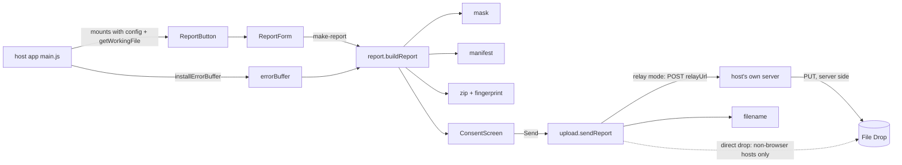

# Code map

Describes commit: 7304979 (2026-10-28)

Status: every module below is a **stub** (checked 2026-10-28: each function throws `NotBuilt`, each component renders a placeholder; nothing has been built since the skeleton). Move a row to **present** in the PR that builds it.

## Layout

| Path | Owns | Status | Musts |
|---|---|---|---|
| `src/index.js` | Public exports: `installErrorBuffer`, `buildReport`, `MAX_SCREENSHOT_BYTES`, `sendReport`, and the components `ReportButton`, `ReportForm`, `ConsentScreen` (`package.json` `exports` points here) | present (re-exports) | - |
| `src/core/errorBuffer.js` | `installErrorBuffer({ size = 200 } = {}) -> { lines(): string[], uninstall(): void }`; `formatLine(level, args, date) -> string` | stub | M2 |
| `src/core/notBuilt.js` | `NotBuilt`, the error every stub function throws; delete it with the last stub | present | - |
| `src/core/mask.js` | `maskText(text, { userName }) -> string` | stub | M6 |
| `src/core/manifest.js` | `buildManifest({ config, files, workingFileIncluded, screenshotIncluded, sentAsIs, now, userAgent }) -> object` | stub | M3 |
| `src/core/filename.js` | `dropFileName(app, now, randomHex) -> string` (`<App>-web-<YYYYMMDDTHHMMSSZ>-<8 hex>.zip`) | stub | M9 |
| `src/core/zip.js` | `buildZip(entries: {name, data: Uint8Array}[]) -> Uint8Array`; `fingerprint(bytes) -> Promise<string>` (hex SHA-256) | stub | M7 |
| `src/core/report.js` | `buildReport({ config, whatHappened, expected, screenshot, includeWorkingFile, getWorkingFile, errorLines }) -> Promise<Report>` where `Report = { files: {name, size, data, sentAsIs}[], zip, fingerprint, manifest }`; `MAX_SCREENSHOT_BYTES = 8 * 1024 * 1024` | stub | M3-M7 |
| `src/core/upload.js` | `sendReport(report, { relayUrl, headers, dropBase, dropToken, app, fetchImpl = fetch, sleep, now, randomHex }) -> Promise<{ ok: boolean, status?: number, message: string }>`. **Relay mode** (the page's mode): when `relayUrl` is set, POSTs the zip as multipart (one field `report`, file name `dropFileName`, `credentials: 'same-origin'`, `redirect: 'error'`, the configured `headers` only) to the host's own server; any 2xx is sent; 5xx and network errors retry 3 times (1 s, 2 s), 4xx do not; messages for 401/403, 413, 429, other 4xx and 5xx/network never include the response body or headers. A failed relay POST never falls back to the drop. **Direct drop** (`dropBase` + `dropToken`, no `relayUrl`): PUT straight to the File Drop, for non-browser hosts only, never in a page. `relayUrl` with `dropBase` or `dropToken` is refused before any fetch. The fingerprint is checked first | stub | M9, M10 |
| `src/core/relay.js` | `relayProblem(config) -> string` (`''` when fine; the conflict and bad-`relayUrl` messages); `isAllowedRelayUrl(relayUrl) -> boolean` (same origin as the page; https, or http on `localhost`/`127.0.0.1`; no credentials) | present | M9, M10 |
| `src/components/ReportButton.vue` | The button; owns open/closed state; props `config`, `getWorkingFile` | stub | M1 |
| `src/components/ReportForm.vue` | The form fields, screenshot picker, working-file box (always starts unticked); emits `make-report` | stub | M1, M4, M5 |
| `src/components/ConsentScreen.vue` | File list with sizes and Show me, "Not sent yet", Send / Keep / Delete; refuses a changed fingerprint | stub | M8, M9 |
| `src/standalone.js` | `mountReportButton(el, { config, getWorkingFile }) -> { unmount() }` and a re-export of `installErrorBuffer`, for hosts without Vue (NeoCraft); built as `dist/craft-bugreport-web.standalone.js` (ESM) and `.iife.js` (global `CraftBugreport`), Vue bundled, CSS in `dist/craft-bugreport-web.standalone.css` | present | M1 |
| `tests/skeleton.test.js` | Smoke test: the public surface and the core functions exist. Each module's issue adds its own `tests/<module>.test.js` (Vitest, jsdom) and trims this file | present (smoke only) | all |
| `package.json`, `vite.config.mjs`, `vitest.config.mjs`, `eslint.config.mjs` | One runtime dependency, `fflate`; Vue 3 is a peer dependency. Vite library mode builds `src/index.js` to one ESM file `dist/craft-bugreport-web.js` with Vue external (`vite.config.mjs`). `vite.standalone.config.mjs` builds `src/standalone.js` with Vue bundled, as ESM and IIFE; `npm run build` runs both in sequence. No lockfile yet | present | - |

## How it fits together

## Report format (must match the desktop launcher)

- Zip entries: `what-happened.txt` ("What happened:\n<text>\n\nWhat I expected:\n<text>\n"), `app.log` (error buffer lines), `manifest.json`, `screenshot.<ext>` (optional), `working-file.<ext>` (optional). No folder inside the zip.
- `manifest.json`: `kind` "manual", `app`, `version`, `commit`, `os`, `arch`, `exit` null, `signature` null, `created` (ISO UTC), `files[]` (entry names), `working_file_included`, `screenshot_included`, `names_masked`, `sent_as_is[]`, plus `nextcloud` (version string) and `browser` (name and version).
- Name in the drop: `<App>-web-<UTC>-<8 hex>.zip`; the drop never overwrites.

## Host app integration

1. `npm install github:iannitram/craft-bugreport-web#v1.0.0`.
2. Call `installErrorBuffer()` first thing in `main.js`.
3. Render `<ReportButton :config :get-working-file>` in the app's navigation or settings area.
4. Pass `relayUrl` (a URL on the app's own origin) and `headers` (`requesttoken` for Nextcloud) in `config`. The app's server route forwards the zip to the File Drop with its own `bug_drop_base` and `bug_drop_token`; the page never gets a drop address or token. Passing both `relayUrl` and `dropBase`/`dropToken` is refused. See README, "Sending from a page: relay mode". Direct drop (`dropBase`, `dropToken`) is for non-browser hosts only.

## Build and test

`npm install`, `npm run lint`, `npm test`, `npm run build` (two Vite builds: the library, ESM with Vue external; the standalone bundles, ESM and IIFE with Vue inside). `tests/standalone.bundle.test.js` reads the standalone bundles and skips them when they are not built; CI runs it on Linux after the build. CI: `.github/workflows/check.yml` runs the tests on Linux, macOS and Windows (GitHub-hosted runners); lint and the build run on Linux only, because ESLint hung on the Windows runner. It uses `npm install` until a lockfile lands.
