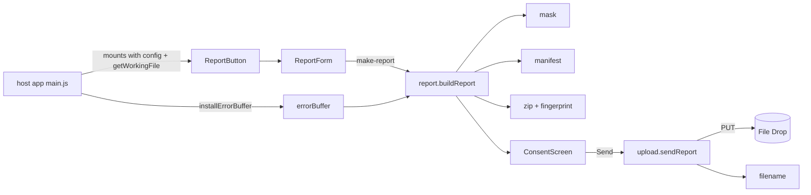

# Code map

Status: every module below is a **stub** (2026-10-26). Move a row to **present** in the PR that builds it.

## Layout

| Path | Owns | Status | Musts |
|---|---|---|---|
| `src/index.js` | Public exports: `installErrorBuffer`, `buildReport`, `sendReport`, `ReportButton` | present (re-exports) | - |
| `src/core/errorBuffer.js` | `installErrorBuffer({ size = 200 } = {}) -> { lines(): string[], uninstall(): void }`; `formatLine(level, args, date) -> string` | stub | M2 |
| `src/core/mask.js` | `maskText(text, { userName }) -> string` | stub | M6 |
| `src/core/manifest.js` | `buildManifest({ config, files, workingFileIncluded, screenshotIncluded, sentAsIs, now, userAgent }) -> object` | stub | M3 |
| `src/core/filename.js` | `dropFileName(app, now, randomHex) -> string` (`<App>-web-<YYYYMMDDTHHMMSSZ>-<8 hex>.zip`) | stub | M9 |
| `src/core/zip.js` | `buildZip(entries: {name, data: Uint8Array}[]) -> Uint8Array`; `fingerprint(bytes) -> Promise<string>` (hex SHA-256) | stub | M7 |
| `src/core/report.js` | `buildReport({ config, whatHappened, expected, screenshot, includeWorkingFile, getWorkingFile, errorLines }) -> Promise<Report>` where `Report = { files: {name, size, data, sentAsIs}[], zip, fingerprint, manifest }`; `MAX_SCREENSHOT_BYTES = 8 * 1024 * 1024` | stub | M3-M7 |
| `src/core/upload.js` | `sendReport(report, { dropBase, dropToken, app, fetchImpl = fetch, sleep, now, randomHex }) -> Promise<{ ok: boolean, status?: number, message: string }>` | stub | M9, M10 |
| `src/components/ReportButton.vue` | The button; owns open/closed state; props `config`, `getWorkingFile` | stub | M1 |
| `src/components/ReportForm.vue` | The form fields, screenshot picker, working-file box (always starts unticked); emits `make-report` | stub | M1, M4, M5 |
| `src/components/ConsentScreen.vue` | File list with sizes and Show me, "Not sent yet", Send / Keep / Delete; refuses a changed fingerprint | stub | M8, M9 |
| `src/standalone.js` | `mountReportButton(el, { config, getWorkingFile }) -> { unmount() }` for hosts without Vue (NeoCraft); built as `dist/craft-bugreport-web.standalone.js` with Vue bundled | stub (not yet created, #13) | M1 |
| `tests/*.test.js` | One test file per module (Vitest, jsdom) | smoke tests only | all |

## How it fits together

## Report format (must match the desktop launcher)

- Zip entries: `what-happened.txt` ("What happened:\n<text>\n\nWhat I expected:\n<text>\n"), `app.log` (error buffer lines), `manifest.json`, `screenshot.<ext>` (optional), `working-file.<ext>` (optional). No folder inside the zip.
- `manifest.json`: `kind` "manual", `app`, `version`, `commit`, `os`, `arch`, `exit` null, `signature` null, `created` (ISO UTC), `files[]` (entry names), `working_file_included`, `screenshot_included`, `names_masked`, `sent_as_is[]`, plus `nextcloud` (version string) and `browser` (name and version).
- Name in the drop: `<App>-web-<UTC>-<8 hex>.zip`; the drop never overwrites.

## Host app integration

1. `npm install github:iannitram/craft-bugreport-web#v1.0.0`.
2. Call `installErrorBuffer()` first thing in `main.js`.
3. Render `<ReportButton :config :get-working-file>` in the app's navigation or settings area.
4. Get `dropBase` and `dropToken` from the server (initial state from the app's own config); never commit them.

## Build and test

`npm install`, `npm run lint`, `npm test`, `npm run build` (Vite library mode, ESM, Vue external). CI: `.github/workflows/check.yml`.
